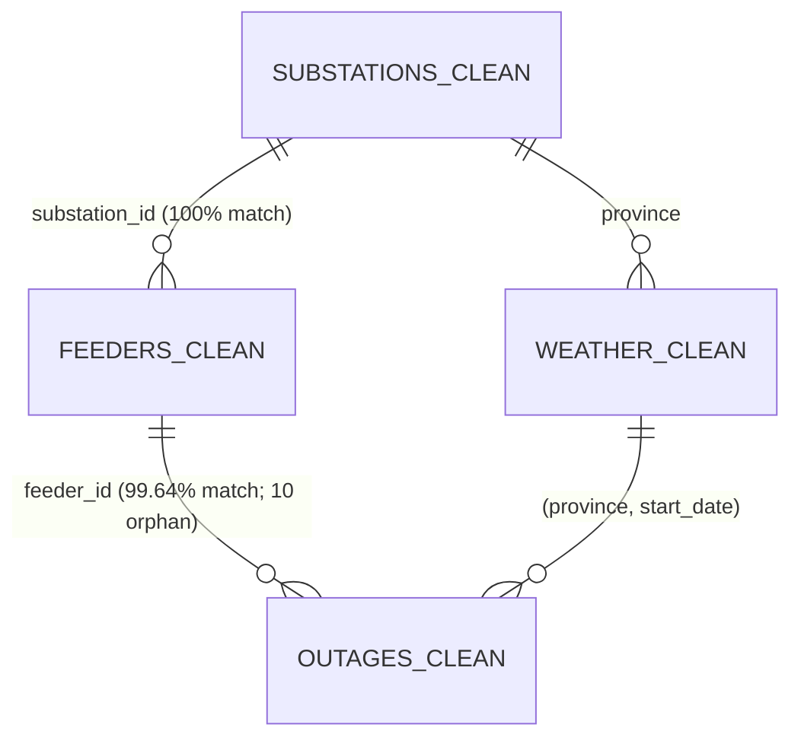

# พจนานุกรมข้อมูลฉบับสมบูรณ์ (Data Dictionary — Phase 1 / Mission A)

> **ชุดข้อมูล:** บริษัท ล้านนาพาวเวอร์ดิสทริบิวชัน จำกัด (4 จังหวัดภาคเหนือ: เชียงใหม่, ลำพูน, ลำปาง, เชียงราย)  
> **กรอบเวลา:** `2023-01-01` ถึง `2024-12-31 23:59` (ข้อมูลทะเบียนสายป้อนส่งออก `2025-01-05`)  
> **รูปแบบไฟล์สะอาด:** `data/clean/*.parquet` และ `data/clean/*.csv` (UTF-8 BOM) · ตัวอย่างทดสอบใน `sample/*_sample.csv`

---

## 1. แผนภาพความสัมพันธ์ระหว่างตาราง (Entity-Relationship Model)

---

## 2. ตารางเปรียบเทียบก่อน–หลังทำความสะอาด (Before vs. After Summary)

| ตาราง | แถวดิบ | แถวหลัง Clean | PK / FK Integrity | ค่าว่างคงเหลือสำคัญ | การทำความสะอาดหลัก |
|---|---:|---:|---|---|---|
| **`outages_clean`** | 2,843 | **2,743** *(Unplanned 2,594 · Planned 149)* | PK: `outage_id` (100% unique) FK: `feeder_id` **99.64%** (`2,733/2,743`, 10 orphan flagged) | `duration_min`: 11 (เติมใน `duration_min_imputed`: 0) `customers_affected`: 68 (เติมใน `customers_affected_imputed`: 0) | ตัดแถวซ้ำ 68 + ซ้ำข้ามช่องทาง 32, แปลง พ.ศ. 250 แถว, แก้ปีผิด 5 แถว, สลับเวลา 13 แถว, แปลงชั่วโมง→นาที 41 แถว, ล้าง `9999/99999/14400` 8 แถว, แก้ `customers > feeder` 16 แถว, ลบ `crew < 0` 8 แถว, รวมสาเหตุ 26→8 กลุ่ม |
| **`feeders_clean`** | 55 | **54** | PK: `feeder_id` (100% unique) FK: `substation_id` 100% | `customers_served_raw`: 2 (`CMI-F02`, `LPG-F12`) `customers_served`: 0 (imputed) | ลบ `CMI-F18` ซ้ำ 1 แถว, แปลงเมตร→กม. (`>1000`) 4 สาย, ประมาณค่า `Customers` ที่ขาด 2 สาย (`204,615` → `214,266` ราย) |
| **`substations_clean`** | 8 | **8** | PK: `substation_id` (100% unique) | 0 | Flatten `location.province` และ `location.region`, แปลง `"75 MVA"` → `75` |
| **`weather_clean`** | 2,899 | **2,899** | PK: `(date, province)` (100% unique) | `rainfall_mm`: 40 (จาก sentinel `-999`) ขาดจากปฏิทิน 25 province-days | แปลง °F→°C 60 แถว (ลำพูน มิ.ย.–ก.ค. 2566), แทนที่ `-999` ด้วย `NaN`, แปลง `thunderstorm` `Y/N` → boolean |
| **`outages_enriched`** | — | **2,743** (61 คอลัมน์) | Left-joined จาก `outages_clean` | คงครบทุก 2,743 เหตุการณ์ (10 orphan ไม่มี metadata สายป้อน; 33 เหตุการณ์ไม่มีข้อมูลอากาศวันนั้น) | รวมข้อมูลเหตุการณ์ + สายป้อน + สถานี + สภาพอากาศเพื่อใช้วิเคราะห์และสร้าง dashboard |

---

## 3. รายละเอียดคอลัมน์รายตาราง (Schema & Transformation Rules)

### 3.1 `outages_clean` (2,743 แถว · 41 คอลัมน์)

| คอลัมน์ | ชนิดข้อมูล | Key | หน่วย / ค่าที่เป็นไปได้ | Nulls | นิยามและกฎการแปลงข้อมูล |
|---|---|---|---|---:|---|
| `outage_id` | `string` | **PK** | `OUT-YYYY-NNNNNN` / `OUT-CC-...` | 0 | รหัสเหตุการณ์มาตรฐาน ตัวพิมพ์ใหญ่ทั้งหมด (unique 100%) |
| `feeder_id` | `string` | **FK** | `XXX-FNN` (เช่น `CRI-F11`) | 0 | รหัสสายป้อนหลัง normalize จาก 108 รูปแบบที่เขียนไม่ตรงมาตรฐาน |
| `feeder_id_raw` | `string` | — | ข้อความดิบ | 0 | รหัสสายป้อนเดิมก่อน normalize (เก็บไว้ตรวจสอบย้อนกลับ) |
| `start_time` | `datetime64[ns]` | — | `2023-01-01` – `2024-12-31` | 0 | เวลาเริ่มไฟดับ (แปลง พ.ศ.→ค.ศ., ตัด `+07:00`, กู้ปีผิด 5 แถว, สลับกับ `end_time` 13 แถว) |
| `end_time` | `datetime64[ns]` | — | timestamp | 11 | เวลาจ่ายไฟคืน (กู้คืนจาก `start_time + duration_min` 79 แถว; ว่างเมื่อขาดทั้ง `end_time` และ `duration_min`) |
| `duration_min` | `float64` | — | นาที (`2.0 – 4,159.0`) | 11 | ระยะเวลาดับสุทธิ: แปลงชั่วโมง→นาที (41 แถว), กู้จาก timestamp (107 แถว), ล้าง `>=9999` (8 แถว) |
| `duration_min_raw` | `float64` | — | นาที / ชั่วโมง / sentinel | 109 | ค่าดิบก่อนคลีน (`-1,375` ถึง `99,999`) |
| `duration_min_imputed` | `float64` | — | นาที (`2.0 – 4,159.0`) | 0 | เติม 11 แถวที่ว่างด้วยค่ามัธยฐานของกลุ่ม `(area_type, cause)` |
| `customers_affected` | `Int64` | — | ราย (`2 – 7,593`) | 68 | จำนวนผู้ใช้ไฟที่กระทบ: แปลง `"1,250"` และแทนที่ค่าเกินจริง (`> feeder.Customers` 16 แถว) ด้วยมัธยฐานปกติของสายป้อน/ประเภท |
| `customers_affected_raw` | `Int64` | — | ราย (`2 – 29,178`) | 68 | ค่าดิบหลังลบจุลภาค (ยังคงค่าเกินจริงไว้เปรียบเทียบ) |
| `customers_affected_capped` | `Int64` | — | ราย | 68 | ทางเลือกแบบ cap ค่าที่เกินไว้ที่ `100%` ของ `feeder_customers_served` |
| `customers_affected_imputed` | `Int64` | — | ราย (`2 – 7,593`) | 0 | เติม 68 แถวที่ว่างด้วยมัธยฐานปกติของสายป้อน/ประเภท |
| `cause` | `str` | — | `tree`, `animal`, `equipment`, `lightning`, `vehicle`, `overload`, `planned`, `unknown` | 0 | สาเหตุมาตรฐาน 8 กลุ่ม (รวมจาก 26 คำเรียก + 74 ค่าว่าง → `unknown`) |
| `cause_raw` | `string` | — | ข้อความดิบ | 72 | สาเหตุเดิมก่อนจัดกลุ่ม |
| `outage_type` | `str` | — | `Unplanned`, `Planned` | 0 | ประเภทการดับ (ใช้ `Unplanned` 2,594 แถวในการคำนวณ SAIFI/SAIDI) |
| `report_channel` | `string` | — | `SCADA`, `Call Center 1129`, `Mobile App`, `แผนงาน` | 0 | ช่องทางรับแจ้งเหตุ |
| `crew_arrival_min` | `Float64` | — | นาที (`5.0 – 228.0`) | 284 | เวลาเดินทางถึงหน้างานของทีมช่าง (ล้างค่าติดลบ 8 แถวเป็น `NaN`; คงกรณี `crew > duration` 405 แถวไว้ตามจริง) |
| `crew_arrival_min_raw` | `Float64` | — | นาที (`-54.0 – 228.0`) | 276 | ค่าเวลาเดินทางดิบ |
| `feeder_customers_served` | `float64` | — | ราย | 10 | จำนวนผู้ใช้ไฟทั้งหมดของสายป้อนนั้นจาก `feeders_clean` (ใช้ตรวจเพดาน) |
| `year`, `month`, `year_month`, `hour`, `start_date` | `Int64` / `str` / `datetime` | — | ปฏิทิน | 0 | คอลัมน์เวลาที่แตกจาก `start_time` สำหรับวิเคราะห์แนวโน้มและ join สภาพอากาศ |
| `customer_minutes` | `Float64` | — | นาที-ราย | 79 | `customers_affected × duration_min` |
| `customer_minutes_imputed` | `Float64` | — | นาที-ราย | 0 | `customers_affected_imputed × duration_min_imputed` |
| `customer_minutes_raw` | `Float64` | — | นาที-ราย | 176 | ค่าก่อนคลีน (ใช้เทียบ Before vs. After) |
| **Audit Flags (`13` คอลัมน์)** | `bool` / `boolean` | — | `True` / `False` | 0 | `is_swapped_timestamps`, `is_placeholder_duration`, `is_duration_in_hours_fixed`, `is_duration_recovered`, `is_end_time_recovered`, `is_negative_crew_arrival_cleaned`, `is_orphan_feeder`, `is_customers_exceed_feeder`, `is_customers_missing`, `is_outside_window`, `is_missing_impact_metric`, `is_excluded_from_strict`, `is_extreme_event`, `is_year_repaired` |

### 3.2 `feeders_clean` (54 แถว · 13 คอลัมน์)

| คอลัมน์ | ชนิดข้อมูล | Key | หน่วย / ค่าที่เป็นไปได้ | Nulls | นิยามและกฎการแปลงข้อมูล |
|---|---|---|---|---:|---|
| `feeder_id` | `string` | **PK** | `XXX-FNN` | 0 | รหัสสายป้อนมาตรฐาน (ลบแถวซ้ำ `CMI-F18` 1 แถว) |
| `substation_id` | `string` | **FK** | `SS-XXX-NN` | 0 | รหัสสถานีไฟฟ้าย่อยอ้างอิง `substations_clean.substation_id` |
| `area_type` | `str` | — | `Urban`, `Suburban`, `Rural` | 0 | ประเภทพื้นที่ (รวมจาก 3 ภาษา/ตัวพิมพ์) |
| `length_km` | `Float64` | — | กิโลเมตร (`5.0 – 84.8`) | 0 | ความยาวสายป้อน (แปลงค่าที่บันทึกเป็นเมตร `>1000` ด้วย `÷ 1,000` จำนวน 4 สาย) |
| `length_km_raw` | `Float64` | — | กม. / เมตร | 0 | ความยาวดิบก่อนแก้หน่วย |
| `customers_served` | `Int64` | — | ราย (รวม `214,266`) | 0 | จำนวนผู้ใช้ไฟบนสายป้อน (เติมค่าที่ขาด 2 สายด้วยมัธยฐาน `area_type`) |
| `customers_served_raw` | `Int64` | — | ราย (รวม `204,615`) | 2 | ค่าดิบจากทะเบียน GIS (ว่างใน `CMI-F02` และ `LPG-F12`) |
| `tree_cover` | `string` | — | `low`, `medium`, `high` | 0 | ระดับความหนาแน่นต้นไม้ตามแนวสาย |
| `overhead_pct` | `float64` | — | เปอร์เซ็นต์ (`0 – 100`) | 0 | สัดส่วนสายอากาศ |
| `install_year` | `Int64` | — | ปี ค.ศ. | 0 | ปีที่ติดตั้งสายป้อน |
| **Audit Flags (`3` คอลัมน์)** | `bool` / `boolean` | — | `True` / `False` | 0 | `is_length_converted_from_metres`, `is_customers_served_imputed`, `is_orphan_substation` |

### 3.3 `substations_clean` (8 แถว · 6 คอลัมน์)

| คอลัมน์ | ชนิดข้อมูล | Key | หน่วย / ค่าที่เป็นไปได้ | Nulls | นิยามและกฎการแปลงข้อมูล |
|---|---|---|---|---:|---|
| `substation_id` | `string` | **PK** | `SS-XXX-NN` | 0 | รหัสสถานีไฟฟ้าย่อย |
| `substation_name` | `string` | — | ข้อความ | 0 | ชื่อสถานีไฟฟ้าย่อย |
| `capacity_mva` | `Int64` | — | MVA | 0 | กำลังผลิตหม้อแปลง (แยกตัวเลขจาก `"75 MVA"` ของ `SS-LPN-01`) |
| `commissioned_year` | `Int64` | — | ปี ค.ศ. | 0 | ปีที่เริ่มใช้งานสถานี |
| `province` | `str` | — | เชียงใหม่, ลำพูน, ลำปาง, เชียงราย | 0 | แตกจาก `location.province` ใน JSON |
| `region` | `string` | — | `ภาคเหนือ` | 0 | แตกจาก `location.region` ใน JSON |

### 3.4 `weather_clean` (2,899 แถว · 10 คอลัมน์)

| คอลัมน์ | ชนิดข้อมูล | Key | หน่วย / ค่าที่เป็นไปได้ | Nulls | นิยามและกฎการแปลงข้อมูล |
|---|---|---|---|---:|---|
| `date` | `datetime64[ns]` | **PK** | `2023-01-01` – `2024-12-31` | 0 | วันที่สังเกตการณ์ (ยังขาดจากปฏิทิน 25 province-days) |
| `province` | `str` | **PK** | 4 จังหวัดภาคเหนือ | 0 | จังหวัดที่ตรวจวัด |
| `rainfall_mm` | `Float64` | — | มิลลิเมตร (`0.0 – 186.4`) | 40 | ปริมาณน้ำฝนรายวัน (แทนที่ค่า sentinel `-999.0` ด้วย `NaN`) |
| `rainfall_mm_raw` | `Float64` | — | มม. (`-999.0 – 186.4`) | 0 | ค่าดิบก่อนล้าง sentinel |
| `max_temp_c` | `Float64` | — | °C (`24.4 – 40.5`) | 0 | อุณหภูมิสูงสุด (แปลง °F `84.0–95.5` ในลำพูน มิ.ย.–ก.ค. 2566 เป็น °C 60 แถว) |
| `max_temp_c_raw` | `Float64` | — | °C / °F | 0 | ค่าอุณหภูมิดิบ |
| `max_wind_kmh` | `Float64` | — | กม./ชม. | 0 | ความเร็วลมสูงสุดรายวัน |
| `thunderstorm` | `boolean` | — | `True` / `False` | 0 | แปลงจาก `'Y'` / `'N'` |
| **Audit Flags (`2` คอลัมน์)** | `boolean` | — | `True` / `False` | 0 | `is_rainfall_sentinel_cleaned`, `is_temp_converted_from_f` |

### 3.5 `outages_enriched` (2,743 แถว · 61 คอลัมน์)
- เกิดจากการ **Left Join**: `outages_clean` $\rightarrow$ `feeders_clean` (บน `feeder_id`) $\rightarrow$ `substations_clean` (บน `substation_id`) $\rightarrow$ `weather_clean` (บน `start_date = date` และ `province`)
- **Nulls จาก Left Join:** 10 แถวที่ `is_orphan_feeder = True` จะมีค่าว่างในคอลัมน์สายป้อน/สถานี/จังหวัด และมีอีก 23 แถว (รวมเป็น 33 แถว) ที่วันที่เกิดเหตุตรงกับวันที่ข้อมูลอากาศขาดหาย (`weather_missing_province_days = 25`)
